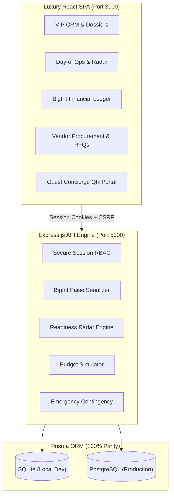

# The Royal Knot — Unified Wedding Operations & Planning Management System

[](https://nodejs.org/)
[](https://www.typescriptlang.org/)
[](https://react.dev/)
[](https://vitejs.dev/)
[](https://www.prisma.io/)
[](https://tailwindcss.com/)
[](https://vitest.dev/)
[]()

> An enterprise luxury destination wedding operations, financial ledger, and day-of execution platform engineered specifically for high-end wedding planning agencies managing royal palace celebrations across Rajasthan and worldwide.

---

## 🎥 Official System Walkthrough & Feature Demo

Watch the complete guided video tour demonstrating the full luxury wedding lifecycle — VIP enquiry intake, touch contract signing, milestone timeline automation, multi-vendor RFQ comparison matrices, double-entry financial settlements with zero margin leakage, and the 5 Phase 8 special features (Readiness Radar, Budget Simulator, Guest QR Portal, Contingency Planner, and Vendor Reliability):

<div align="center">
  <video src="./client/public/recordings/the-royal-knot-official-demo.webm" width="100%" controls="controls" poster="./client/public/royal-wedding-palace.jpg">
    <p>Your browser does not support the video tag. <a href="./client/public/recordings/the-royal-knot-official-demo.webm">Download or play the official demo video directly</a>.</p>
  </video>
  <br/>
  <p>
    🎬 <strong><a href="./client/public/recordings/the-royal-knot-official-demo.webm">▶ Play / Download Official Demo Video (`the-royal-knot-official-demo.webm`)</a></strong> &nbsp;|&nbsp; 
    🖥️ <strong><a href="./client/public/demo-showcase.html">Interactive Browser Showcase Page</a></strong>
  </p>
</div>

---

## 🏛️ Platform Highlights & Core Capabilities

The Royal Knot brings together luxury concierge service, minute-by-minute operational execution, and auditable financial discipline into a unified system.



### 1. VIP Client CRM & Touch Service Agreements (Developer A)
- **VIP Intake Pipeline**: Status tracking from initial enquiry to consultation, proposal, contract review, and confirmed wedding dossier.
- **Consultation Scheduling**: Calendar booking with couple dossiers, guest headcount, and palace venue selections.
- **Service Agreements & Touch Signature**: Real-time canvas for capturing digital couple signatures directly in the browser with immutable timestamping and audit trails.

### 2. Wedding Portfolios & Automated Milestone Tasks (Developer A)
- **Multi-Day Itinerary Tracking**: Multi-ceremony support (Mehndi, Sangeet, Haldi, Royal Baraat, Varmala, Reception).
- **Automated Milestone Pipeline**: Rule-driven generation of critical timeline tasks triggered dynamically upon wedding creation.
- **Staff Roster & Task Assignment**: Role-based assignment with real-time progress monitoring.

### 3. Day-Of Minute-by-Minute Operations & Incident Command (Developer A)
- **Live Timeline**: Minute-by-minute run-of-show with visual delay alerts and real-time activity status indicators.
- **Incident Escalation Matrix**: Log, assign, and resolve operational incidents with priority escalation (`LOW`, `MEDIUM`, `HIGH`, `CRITICAL`).

### 4. Vendor Procurement & RFQ Comparison Matrix (Developer B)
- **Vendor Directory**: Categorized directory covering royal florists, palace caterers, royal band & dhol, decor, and heritage photographers.
- **RFQ Quotation Workflow**: Generate quotation requests, receive structured line-by-line bids from multiple vendors, and inspect automated comparison matrices.
- **Award & Contract Baseline**: Formally award winning vendors to freeze cost baselines.

### 5. Double-Entry Financial Ledger & Indian Paise Currency (Developer B)
- **BigInt Paise Precision**: All currency calculations operate using integer `BigInt` paise to eliminate floating-point rounding errors on multi-crore destination weddings.
- **Anti-Double-Counting Reconciliation**: Pass-through direct expenses and vendor bills reconcile cleanly against client invoices with zero margin leakage.
- **Live Profitability & Founder Analytics**: Real-time margin analytics, cash flow forecasting, and revenue metrics.

### 6. Role-Based Access Control (RBAC) & Session Security
- **Role Hierarchy**: 5 distinct roles (`FOUNDER`, `LEAD_PLANNER`, `COORDINATOR`, `FINANCE_DIRECTOR`, `ADMIN`).
- **Cryptographic Password Hashing**: Robust `scrypt` hashing with unique cryptographic salts (`scrypt:<salt>:<hash>`).
- **HTTP-Only Cookies & CSRF Protection**: Session token stored in secure HTTP-only cookies paired with in-memory double-submit CSRF headers.

### 7. Phase 8 Special Features
1. **Wedding Readiness Radar**: Comprehensive 5-factor scoring engine evaluating timeline staffing, vendor readiness, contract execution, budget variance, and open incidents.
2. **Budget Impact Simulator**: Real-time scenario projection modeling guest headcount swings and luxury add-on packages with planner agency commission calculations.
3. **Guest Concierge QR Portal**: Tokenized public portal for wedding guests to confirm RSVP attendance, dietary requirements, and access shuttle timings without needing system credentials.
4. **Contingency & Backup Planner**: Weather and operational emergency protocol activator with indoor venue relocation workflows and post-incident reviews.
5. **Vendor Reliability Intelligence**: Historical vendor reliability algorithm measuring timeliness, quality, invoice variance, and communication responsiveness.

---

## 📁 Monorepo Architecture

```
Wedding-Planning-Management-System/
├── shared/                 # Shared TypeScript contracts, schemas & utilities
│   ├── src/constants/      # RBAC permissions, role definitions, contingency configs
│   ├── src/schemas/        # Zod validation schemas for auth, RFQ, CRM, and ops
│   ├── src/types/          # Shared DTOs and TypeScript interfaces
│   └── src/utils/          # BigInt Indian currency parser (₹ Lakhs / Crores)
├── server/                 # Express.js REST API backend
│   ├── prisma/             # Dual Prisma schemas (SQLite & PostgreSQL) & migrations
│   │   ├── schema.prisma   # SQLite development schema
│   │   ├── schema.postgres.prisma # PostgreSQL production schema
│   │   └── seed.ts         # Deterministic demo database seeder
│   ├── src/middleware/     # Session authentication, RBAC guard, BigInt serializer
│   ├── src/routes/         # Auth, CRM, WeddingOps, DayOfOps, Finance, Admin, Portal
│   ├── src/services/       # Business logic engines & transactional workflows
│   └── tests/              # 24 Vitest integration & unit test suites (102 tests)
├── client/                 # Vite + React luxury SPA
│   ├── public/             # Palace background visuals, demo recordings & interactive showcase HTML
│   │   └── recordings/     # High-definition system demonstration video (WebM)
│   ├── src/components/     # Modular UI components (CRM, Operations, Finance, Portal)
│   ├── src/features/       # Specialized modules (Vendors, Founder Analytics)
│   ├── src/contexts/       # React AuthContext and session state
│   └── src/theme/          # Design tokens (Cormorant Garamond & DM Sans palette)
├── scripts/                # Automated verification and Playwright demo scripts
├── Dockerfile              # Multi-stage production container build
├── docker-compose.yml      # Container orchestration (Node + PostgreSQL)
├── render.yaml             # Render Blueprint for 1-click cloud deployment
├── vercel.json             # Optional Vercel client deployment with API proxy rewrites
└── DEPLOYMENT.md           # Comprehensive operations & cloud deployment guide
```

---

## 🔑 Demonstration User Accounts

All demonstration accounts are configured with the demo password defined in `DEMO_USER_PASSWORD` (default: `RoyalKnot#LocalDev2026`):

| Role | Email Address | Password | Accessible Modules |
| :--- | :--- | :--- | :--- |
| **Founder / CEO** | `founder@royalknot.in` | `RoyalKnot#LocalDev2026` | Full Access: Executive Analytics, Finance, CRM, Ops, Vendors |
| **Lead Planner** | `lead.planner@royalknot.in` | `RoyalKnot#LocalDev2026` | CRM Enquiries, Wedding Portfolios, Service Agreements, Day-of Ops |
| **Operations Coordinator** | `operations@royalknot.in` | `RoyalKnot#LocalDev2026` | Day-of Minute Timeline, Readiness Radar, Incident Command, Staff Roster |
| **Finance Director** | `finance@royalknot.in` | `RoyalKnot#LocalDev2026` | Financial Ledger, RFQ Quotes, Vendor Settlements, Client Invoices |
| **Administrator** | `admin@royalknot.in` | `RoyalKnot#LocalDev2026` | Admin Console, User Directory, Demo Data Explorer |

---

## 📄 License & Team

Developed for **The Royal Knot Luxury Wedding Operations** by **Team 25**. All rights reserved.
